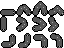

# WEINER motion review

The source sheet is 64×48 pixels with twelve contiguous 16×16 review cells.
It is not converted or loaded by the game.

| Row | Poses from left to right |
|---|---|
| 1 | flat extension, rear bunch, peak arch, forward extension; moving right |
| 2 | separately drawn vertical-down equivalents of row 1 |
| 3 | two internal-corner turns, then two external-edge wraps |

The face remains a small mark at the leading endpoint while the body bunches
behind it. Horizontal and vertical flips can supply the other travel directions,
but Game Boy hardware cannot rotate a sprite 90 degrees, so accepted vertical
poses will require their own tile data.

The revised horizontal cycle, with its leading face planted on the floor, was
accepted on 2026-10-13. Vertical and corner poses remain exploratory.
