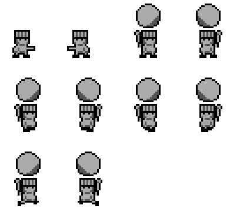

# HEAVE art review

The original OAM-overlay prototype could not reliably conceal Chef's existing
arm. This revision replaces the affected body tiles while sharing unchanged
tiles between poses. Each pair shows the right- and left-facing composition.
Read pairs from left to right, then top to bottom:

1. reach; carrying idle
2. carrying movement frames 0 and 1
3. carrying jump

The carrying poses share two upper tiles. Reach, idle, two movement frames, and
jump each use two lower tiles. Both directions reuse the same twelve new tiles
through hardware X-flip. Chef continues using his four normal OAM entries; the
carried egg retains its existing tiles and dynamic OAM entries. The current
fourteen-tile reserve retains two unused tile indices.
